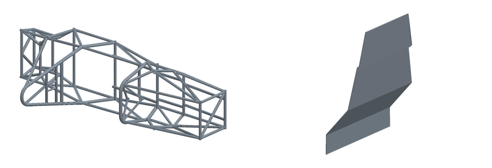
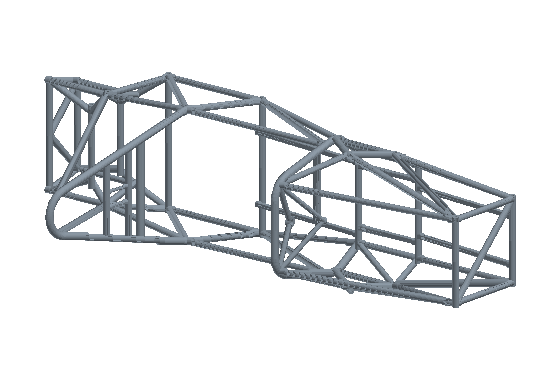

# cad-to-usd

Turn SOLIDWORKS parts into simulation-ready assets **without opening SOLIDWORKS**.

`cad-to-usd` reads the tessellated display mesh that SOLIDWORKS saves inside every
`.SLDPRT`, validates it, and exports it as:

- **USD (`.usda`)** for NVIDIA Isaac Sim / Omniverse, optionally with rigid-body physics,
  a collider and a material density, so the part can fall, collide and be pushed as soon as
  it is referenced into a scene
- **Wavefront OBJ** for Blender, MeshLab and most other tools
- **PNG previews and turntable GIFs** from a small NumPy/Pillow renderer (no GPU needed)



*My chassis and driver firewall designs for the HKUST Red Bird Racing Formula Student
car, rendered straight from their saved display meshes.*



## Why

Simulation scenes need meshes that match the real hardware. Engineering parts usually
live in native CAD files, and converting them normally means a CAD licence, manual
export steps, and checking units and up axes by hand. This tool makes that step
scriptable and repeatable for a whole folder of parts.

## Install and use

```bash
pip install -e ".[test]"

# USD for Isaac Sim (Z up, metres), with physics
cad-to-usd parts/*.SLDPRT -o out --usd --rigid-body --density 2700

# frames and other concave parts: use a convex decomposition collider
cad-to-usd chassis.SLDPRT -o out --usd --rigid-body --collider convexDecomposition

# OBJ + four preview images + a turntable GIF
cad-to-usd rocker.SLDPRT -o out --obj --render --turntable
```

From Python:

```python
from cad_to_usd import load_mesh
from cad_to_usd.export import write_usda

mesh = load_mesh("rocker.SLDPRT")
print(mesh.summary())   # faces, vertices, triangles, size in metres
write_usda(mesh, "rocker.usda", name="Rocker", rigid_body=True, density=7850)
```

## How it works

1. **Container** (`container.py`). Modern SOLIDWORKS files hold a sequence of
   deflate-compressed stream records with nibble-swapped names. Every stream is
   accepted only if it inflates to the stored size and matches its CRC-32.
2. **Display mesh** (`displaylists.py`). The `Contents/DisplayLists` stream stores each
   CAD face as triangle strips with unit normals and a stored bounding box. Each face
   record is validated (strip lengths partition the vertices, array lengths agree,
   normals are unit length, every vertex lies inside the stored bounds) before its
   strips are unrolled into triangles with consistent counter-clockwise winding.
3. **Export** (`export.py`). Geometry is kept in metres. SOLIDWORKS is Y up, so for USD
   the mesh is rotated +90° about X into Isaac Sim's Z-up convention; the rotation is
   proper (det = +1), so face winding and normals stay outward.
4. **Physics** (optional). The root prim gets `PhysicsRigidBodyAPI` (and `PhysicsMassAPI`
   with a density), and the mesh gets `PhysicsCollisionAPI` with a PhysX approximation.

Tested on four Formula Student parts (chassis, firewall, rear upright, rocker bracket;
up to 621 faces / 48,888 triangles): every face record passed validation and 100% of triangles agree in winding with the normals saved
by SOLIDWORKS.

## Limits

- The output is SOLIDWORKS' **display tessellation**, not the exact B-rep. It is ideal for
  visuals and collision shapes, not for re-meshing precise FE models.
- Parts saved without display data (some imported or lightweight files) have no
  `DisplayLists` stream and are skipped with a clear message.
- Assemblies (`.SLDASM`) are not resolved yet; export the parts and assemble them in USD.
- The USD writer produces plain `.usda` text that follows the OpenUSD schema. The test
  suite loads it with the official `usd-core` library when that is installed.

## Tests

```bash
pip install -e ".[test,usd]"
pytest
```

Tests build tiny synthetic SOLIDWORKS-style records, so no proprietary CAD files are needed.

## Roadmap

- Load the exported parts into an Isaac Sim scene and compare rigid-body behaviour with
  the real parts
- Assembly support: read part transforms from `.SLDASM` and write one USD per assembly
- Material assignment from SOLIDWORKS material names (density, display colour)

## Credits

The record layout follows the independent interoperability research in
[blussyya/sldprt-format-research](https://github.com/blussyya/sldprt-format-research).
This project only reads files; it never modifies source CAD.

MIT licence · Seung Wook Chae
